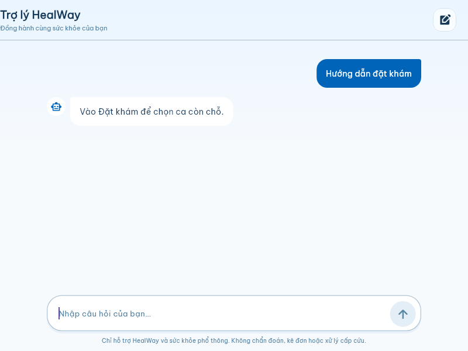
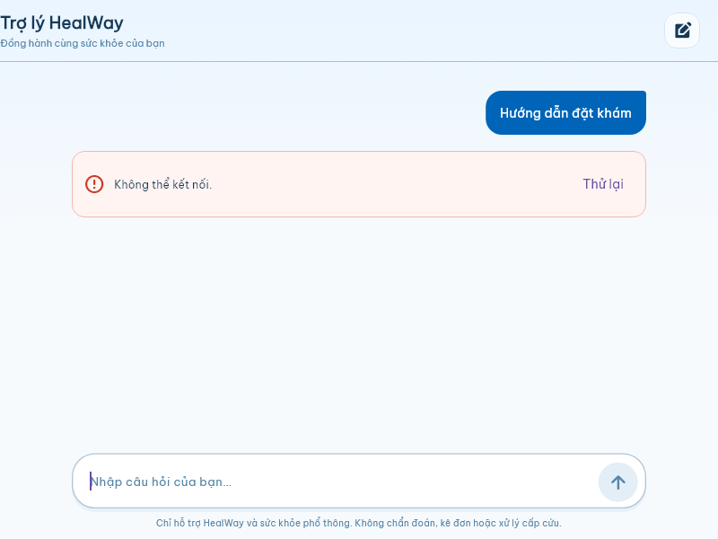
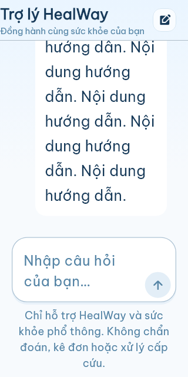

# Sprint 6 — tích hợp NgocVan và báo cáo QA

Ngày thực hiện: 24/10/2026, múi giờ Asia/Saigon. Nhánh làm việc: **NgocVan**.
Nguồn tích hợp: `origin/QuocViet` tại `706b872b0e307f5f4c075fad039e156a80f5e46f`.
QuocViet chỉ được đọc; không commit/push vào nhánh đó. NgocVan trước tích hợp: `50bedfd`.

## Bảng cập nhật từ QuocViet

| Commit mới | Nội dung | Kết quả tích hợp trên NgocVan |
| --- | --- | --- |
| `c77e4d7` | Giao diện chatbot | Giữ giao diện mới, mở từ Chức năng; bổ sung kiểm thử giao diện/điều hướng và cuộn trạng thái chờ. |
| `5389ec0` | Tích hợp giao diện từ KieuTien | Giữ các provider, màn hình và tìm kiếm tiếng Việt; sửa trường hợp kết thúc ghép dấu không đổi text. |
| `082c885` | Backend chatbot qua Worker | Giữ kết nối Worker/OpenAI và lịch sử `LS_CHAT_AI`; hợp nhất Rules với `YEU_CAU_BAC_SI` đang có. |
| `45b5a9c` | Giới hạn sử dụng chatbot | Thay KV read/modify/write bằng SQLite Durable Object có transaction theo UID để chặn gửi đồng thời. |
| `706b872` | Giới hạn và an toàn chatbot v2 | Giữ bộ lọc; bổ sung kiểm tra tài khoản còn hoạt động, toàn bộ lịch sử, lỗi dịch vụ và ngữ cảnh tài khoản. |

Không đưa `workers/chatbot/node_modules` vào cây source cuối của NgocVan. Giữ
`package.json`/lockfile, thêm ignore cho dependency/cache/secret cục bộ. Git vẫn
giữ lịch sử gốc của commit nguồn, không viết lại lịch sử QuocViet.

## Đối chiếu sáu yêu cầu

| Yêu cầu | Thực hiện | Trạng thái và bằng chứng |
| --- | --- | --- |
| AI-06 — cấu hình, quyền và giới hạn | Chặn token thiếu/sai chữ ký/hết hạn/sai project; kiểm tra account hiện tại qua Firestore REST; active role hợp lệ; HTTPS client; CORS; giới hạn 2000 ký tự, 12 turn, 110000 byte, 10 yêu cầu/phút, khoảng cách 2 giây. Thiếu cấu hình/quota storage thì từ chối. Quét khóa source/APK. | PASS tự động. `worker-tests.txt`, `worker-runtime.txt`, `credential-scan.json`, test repository Flutter. |
| AI-09 — bộ câu hỏi HealWay | 24 câu hỏi về sử dụng app, dữ liệu chưa được cung cấp, ngoài phạm vi, nội dung khẩn cấp, thuốc/chẩn đoán và riêng tư; lưu expected/actual/pass-fail. Hướng dẫn ứng dụng thông thường trả lời theo nội dung đã đối chiếu. | 24/24 PASS. [Bảng kết quả](questions-results.md), [JSON kết quả](questions-results.json). Chưa chấm chất lượng mô hình thật. |
| AI-12 — kết nối, riêng tư, nhạy cảm | Test timeout, offline, 401/403/429/5xx, JSON lỗi, reply rỗng/quá dài; không hiển thị lỗi thô từ provider; chặn bí mật trước gửi/lưu; kiểm tra lịch sử cũ và nội dung khẩn cấp có kèm bí mật. Đổi tài khoản/dispose loại bỏ reply cũ. | PASS tự động. Worker/client/controller/widget tests và Rules emulator. |
| ADM-20 — truy vấn tài khoản và quyền Firebase | Giữ truy vấn/duyệt có kiểm soát; chặn thay role qua client và tự duyệt; sửa kiểm tra liên kết `accountKey` cũ ở backend. Tài khoản khóa không tới workspace của cả ba role. | PASS emulator và Flutter auth-flow; quyền chatbot không chỉ dựa vào token. |
| AI-15 — functional/negative test và QA | Có bảng test case, actual result, PASS/FAIL, log và ảnh. Chạy Worker unit/contract, workerd thật với dependency mock, Firestore/Auth emulator và toàn bộ Flutter regression. | PASS trong phạm vi tự động, xem các bảng bên dưới. |
| S6-13 — tích hợp, regression, bàn giao | Admin và chatbot ở cùng App; kiểm tra role routing, Patient/Doctor/Admin regression; build APK release; bàn giao source/test/report và hướng dẫn cấu hình. | Build và regression tự động PASS. **Chưa nghiệm thu production, thiết bị thật và chất lượng AI thật**; không xác nhận “không còn mọi blocker” ngoài phạm vi này. |

## Kết quả chạy thực tế

| Bộ kiểm tra | Actual result | Bằng chứng |
| --- | --- | --- |
| Flutter toàn dự án | **344 PASS, 0 FAIL** | [flutter-regression.txt](evidence/flutter-regression.txt) |
| Flutter analyzer | **No issues found** | [flutter-analyze.txt](evidence/flutter-analyze.txt) |
| Backend admin + Rules + regression Firebase | **40 PASS, 0 FAIL**, chỉ project `demo-*` | [firebase-regression.txt](evidence/firebase-regression.txt) |
| Worker unit/contract/câu hỏi | **58 PASS, 0 FAIL**; gồm 24 câu hỏi, không cộng trùng 24 vào tổng này | [worker-tests.txt](evidence/worker-tests.txt) |
| Runtime workerd + SQLite thật | Gửi 12 yêu cầu đồng thời: **1 thành công, 11 bị giới hạn, 1 lần gọi provider giả lập** | [worker-runtime.txt](evidence/worker-runtime.txt) |
| Worker bundle/config | Wrangler `deploy --dry-run` thành công, có binding `CHAT_LIMITER`; không deploy | [worker-bundle.txt](evidence/worker-bundle.txt) |
| Build Android release | Thành công, khoảng 60.3 MB; theo cấu hình ký debug đang có của dự án, dùng bản bàn giao thử nghiệm | [apk-build.txt](evidence/apk-build.txt) |
| Quét bí mật | Không có chuỗi khớp mẫu khóa OpenAI/private-key trong source và APK | [credential-scan.json](evidence/credential-scan.json) |

Log emulator có các dòng `PERMISSION_DENIED` do các test **mong đợi truy cập bị
từ chối**; kết quả cuối là 40/40 đạt. Đã dùng cổng QA riêng 9380/9399 vì cổng
mặc định có dịch vụ đang sử dụng; không dừng dịch vụ đó.

## Bảng test case functional và negative

| ID | Test case / expected | Actual result | Kết quả | Evidence |
| --- | --- | --- | --- | --- |
| F-01 | Mở chatbot từ Chức năng, gửi và quay lại app | Màn mới mở, nhận reply giả lập, Back về navigation | PASS | Flutter: `Chatbot is a usable support page...` |
| F-02 | Hội thoại theo thứ tự; gửi trùng bị chặn | Một lần gọi khi pending; user trước assistant | PASS | Flutter chatbot controller/page |
| F-03 | Lỗi kết nối có retry | Hiện lỗi; retry giữ một câu hỏi, sau đó nhận reply | PASS | Flutter chatbot page/repository |
| F-04 | Nội dung dài, chữ lớn, màn 320px, bàn phím | Chờ/reply không overflow; cuộn tới tin mới | PASS | Flutter chatbot page; ảnh mobile |
| F-05 | Câu hỏi mẫu đúng hướng dẫn app | 24 câu có expected/actual đạt | PASS | questions-results.md |
| N-01 | Chưa đăng nhập không gọi AI | 401, không gọi provider | PASS | Worker contract |
| N-02 | Token hết hạn/sai audience/issuer/iat/chữ ký | 401, không gọi provider | PASS | Worker contract |
| N-03 | Account khóa/thiếu/quyền không hợp lệ | 403; dịch vụ kiểm tra quyền lỗi trả 503 | PASS | Worker contract |
| N-04 | Thiếu secret hoặc limiter | 503, không gọi provider | PASS | Worker contract |
| N-05 | Gửi đồng thời không vượt quota | 1/12 được chấp nhận trong runtime thật | PASS | worker-runtime.txt |
| N-06 | Quota 10/phút và cooldown | Yêu cầu tiếp theo 429; cửa sổ mới dùng lại được | PASS | Worker limiter test |
| N-07 | Origin ngoài whitelist | 403; origin được phép có CORS preflight 204 | PASS | Worker contract |
| N-08 | Body dài, role giả system, lịch sử không khớp | 400/413, không chuyển tiếp tới AI | PASS | Worker contract |
| N-09 | Mật khẩu/OTP/thẻ/bệnh án ở câu mới hoặc lịch sử cũ | Client chặn trước network; Worker độc lập trả 422 | PASS | Worker + repository tests |
| N-10 | Khẩn cấp nhưng kèm bí mật | Không phản chiếu/lưu bí mật, trả 422 | PASS | Worker contract |
| N-11 | Nội dung ngoài phạm vi và yêu cầu đổi quy tắc | Trả giới hạn phạm vi, không gọi AI | PASS | Safety + bộ câu hỏi |
| N-12 | Nội dung khẩn cấp/thuốc/chẩn đoán | Hướng dẫn an toàn, không trả đơn/liều; không số điện thoại tự bịa | PASS | Safety + bộ câu hỏi |
| N-13 | Provider timeout/offline/429/401/500 | 504/429/503 an toàn, không lộ lỗi thô | PASS | Worker + repository tests |
| N-14 | Provider trả JSON lỗi, rỗng hoặc quá dài | Từ chối lỗi; reply Worker tối đa 2000 ký tự | PASS | Worker + repository tests |
| N-15 | Output provider có bí mật/liều thuốc | Bí mật bị từ chối; mẫu liều thuốc thay bằng phản hồi an toàn | PASS | Worker contract, output giả lập |
| N-16 | Đăng xuất/đổi người dùng khi request pending | Xóa hội thoại, bỏ reply cũ, không lưu cho người mới | PASS | Flutter controller/repository |
| N-17 | Đóng controller trước khi reply về | Không notify sau dispose, không giữ reply | PASS | Flutter controller |
| N-18 | Firestore không lưu được lịch sử | Vẫn hiển thị reply hợp lệ, không báo thành công lưu lịch sử | PASS | Flutter repository |
| R-01 | Đọc/ghi lịch sử người khác hoặc query rộng | Bị Rules chặn; query theo owner và admin read hợp lệ | PASS | Firebase requirements test |
| R-02 | Giả owner/schema/timestamp, sửa/xóa transcript | Bị chặn; khóa account cũng mất quyền đọc/ghi | PASS | Firebase requirements test |
| R-03 | Patient/Doctor/Admin routing và tài khoản khóa | Đúng workspace khi hợp lệ; khóa không vào được | PASS | Flutter auth-flow |
| R-04 | Tài khoản bác sĩ dùng accountKey cũ | Sửa hồ sơ đúng account; không đổi được role đã liên kết | PASS | Firebase admin test |
| R-05 | Bật lịch ngừng bị trùng giờ | Bị từ chối, trạng thái cũ giữ nguyên | PASS | Firebase admin test |
| R-06 | Sửa sức chứa ca đã hủy | Giữ `CANCELLED`, không tự mở nhận đặt | PASS | Firebase admin test |
| R-07 | Xóa lịch/bác sĩ có yêu cầu liên quan | Bị từ chối, không để yêu cầu mất liên kết | PASS | Firebase admin test |
| R-08 | Gõ tiếng Việt: commit composing không đổi text | Cập nhật kết quả sau commit; không áp timer cũ giữa lúc ghép dấu | PASS | Flutter specialty test; admin dùng cùng cách theo dõi controller |
| R-09 | Tạo bác sĩ qua server; mất acknowledgement; email thiết lập lỗi | Request ID/lý do được giữ; backend có receipt/audit; retry không tạo trùng; email lỗi không xóa account | PASS | Flutter provisioner/workspace và Firebase admin test |

## Ảnh bằng chứng widget test







Đây là ảnh widget test với font/icon của app, không phải ảnh từ điện thoại thật.

## Phạm vi và điểm còn tồn tại

- Các bài Worker dùng JWT ký bằng khóa **test**, response Firebase/OpenAI giả lập;
  runtime test chạy workerd và SQLite thật. Không dùng tài khoản hoặc dữ liệu bệnh nhân thật.
- Bộ câu hỏi xác nhận hướng dẫn app và safety routing xác định trước. Chất lượng,
  độ đúng và độ ổn định của phần trả lời từ mô hình thật **chưa được chấm**.
- Bộ lọc từ khóa/mẫu không bảo đảm nhận diện mọi PII, prompt injection hay mọi
  nội dung y khoa không an toàn. Đây không phải chứng nhận an toàn y khoa.
- `store:false` tắt lưu application state ở Responses; không đồng nghĩa nhà cung
  cấp không lưu dữ liệu theo chính sách. Không log prompt/token/API key.
- Chưa deploy Worker/Rules/Function mới, chưa smoke test staging/production và
  chưa cài APK lên thiết bị: `adb devices` không có thiết bị kết nối.
- Các vấn đề đã báo ở đợt audit trước, ngoài phạm vi sửa chính lần này, vẫn cần
  theo dõi: thống kê gộp bác sĩ trùng tên; nhật ký chưa đầy đủ ở luồng duyệt account;
  lựa chọn ca quá hạn chỉ bị chặn khi submit; thông báo
  rỗng kèm lỗi quyền; panel duyệt chỉ 10 mục; hoàn tiền mới tạo yêu cầu; cấu hình
  liên hệ chưa nối đầy đủ; phân trang vẫn tải toàn bộ collection.
- Đã bỏ tạo/xóa secondary Auth user trên client. UI tạo bác sĩ hiện dùng
  `adminCommand(createDoctor)` với requestId/lý do của editor, có audit và receipt;
  retry dùng cùng mã. Lỗi email không xóa tài khoản đã tạo. Có test adapter Flutter
  và test backend emulator cho mất acknowledgement. **Cần deploy Function trước
  khi dùng chức năng tạo bác sĩ của APK mới**, không còn fallback tạo Auth trên client.

## Bàn giao và chạy lại

```powershell
flutter analyze --no-pub
flutter test --no-pub --reporter expanded --dart-define=SPRINT6_CAPTURE=true
node scripts/run-sprint6-emulator.mjs
npm.cmd test --prefix workers/chatbot
npm.cmd run test:runtime --prefix workers/chatbot
node scripts/run-sprint6-question-qa.mjs
flutter build apk --release --no-pub
./scripts/package-sprint6-handoff.ps1
```

Chuẩn bị máy khác: `flutter pub get`, `npm.cmd ci --prefix functions`,
`npm.cmd ci --prefix workers/chatbot`, `npm.cmd ci` tại root nếu chạy Rules root.
Script emulator tạo config/bản sao Rules dưới `build/sprint6-qa`; không sửa
config production. Khóa thật chỉ cấu hình bằng `wrangler secret put`.

Script đóng gói sao chép log/ảnh, quét mẫu credential và cập nhật checksum APK.
Sau khi commit source, chạy lại với `-IncludeSource` để tạo ZIP từ `HEAD` và
`manifest.json` chứa commit/checksum; source ZIP không chứa `.git`/dependency.

Trước nghiệm thu thật: deploy Rules và `adminCommand` tương ứng, deploy Worker
có migration `CHAT_LIMITER` và secret hợp lệ theo `workers/chatbot/README.md`;
build lại với `CHATBOT_WORKER_URL` của môi trường đó. Kiểm tra trên thiết bị với
tài khoản thử của cả ba role, mất mạng và quota; đánh giá câu hỏi sức khỏe bằng
mô hình thật, xử lý các điểm còn tồn tại trước khi kết luận sẵn sàng production.

APK: `build/sprint6-handoff/HealWay-Sprint6.apk`.
Source ZIP: `build/sprint6-handoff/HealWay-Sprint6-source.zip` (snapshot commit bàn giao).
APK SHA-256: `F93120D5669B721B8BF87179A0D6E0A75C9B125BE6E09725112D9A6946626F69`.
